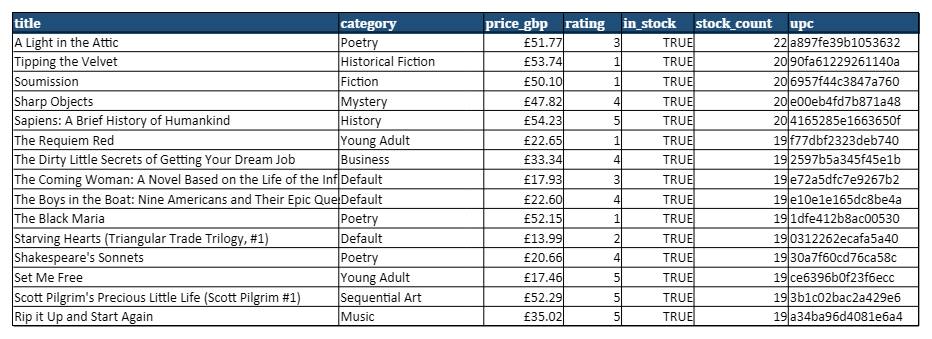
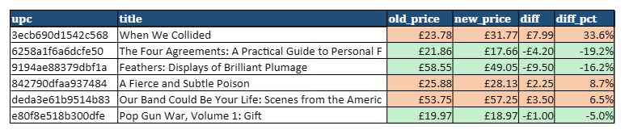

# Python Web Scraping Portfolio

**I extract data from websites into clean Excel/CSV/Google Sheets — with re-runnable scripts.**

[](https://github.com/zhangir777/python-scraping-portfolio/actions/workflows/ci.yml)

**Hire me:** [Upwork](https://www.upwork.com/freelancers/~012c68804f9b4d4550) · [Fiverr](https://www.fiverr.com/akhmetov_zhangi) · [Telegram @ZhangirAkhmetov](https://t.me/ZhangirAkhmetov)



All demos run on sandbox sites built for scraping practice ([books.toscrape.com](https://books.toscrape.com), [quotes.toscrape.com](https://quotes.toscrape.com)). The files in [`samples/`](samples/) are real results of these scripts.

## Projects

### 1. Product catalog → Excel ([`projects/static_catalog`](projects/static_catalog))
All 1,000 books from 50 pages and 50 categories: title, category, price, rating, stock, UPC, links.
Excel is client-ready: styled frozen header, filters, prices as currency, clickable links, and a **Summary** sheet (count, min/max/average price, books per category, collection date). Duplicates removed, broken records logged and skipped.
```bash
uv run scrape-books --out samples/books --format xlsx,csv,json
```
Result: [`samples/books.xlsx`](samples/books.xlsx) · [`books.csv`](samples/books.csv) · [`books.json`](samples/books.json)

### 2. JavaScript site, infinite scroll, login ([`projects/js_dynamic`](projects/js_dynamic))
Real browser (Playwright, headless): pages rendered by JavaScript, infinite scroll until no new items appear, and a login form (credentials from `.env`). `--headed` to watch it, screenshot to `logs/` on error.
```bash
uv run playwright install chromium
uv run scrape-quotes js        # or: scroll, login
```
Result: [`samples/quotes_js.xlsx`](samples/quotes_js.xlsx), [`quotes_scroll.xlsx`](samples/quotes_scroll.xlsx), [`quotes_login.xlsx`](samples/quotes_login.xlsx)

> **When a browser is not needed:** many “JavaScript” sites load data from an internal JSON API. Calling that API directly is 10–50× faster and breaks less often than clicking through pages, so I always check the browser's Network tab first and use Playwright only when there is no usable API.

### 3. Price monitoring ([`projects/price_monitor`](projects/price_monitor))
Compares two snapshots of a catalog: new and removed products, price changes (absolute and %), stock changes. Excel report with price increases in red and drops in green, optional Telegram summary (`--notify`).
```bash
uv run price-monitor tests/fixtures/books_yesterday.csv samples/books.csv --out samples/changes.xlsx
```
Result: [`samples/changes.xlsx`](samples/changes.xlsx).


*Honest note:* the sandbox never changes prices, so the “yesterday” snapshot is the real scrape with a few prices, stock values and products changed on purpose ([`tests/fixtures/books_yesterday.csv`](tests/fixtures/books_yesterday.csv)).
Scheduled runs: [GitHub Actions workflow](.github/workflows/price-monitor.yml) (schedule disabled in the demo) or cron:
```
0 8 * * * cd /path/to/repo && uv run scrape-books --out out/today --format csv && uv run price-monitor out/yesterday.csv out/today.csv --notify && mv out/today.csv out/yesterday.csv
```

## Responsible scraping
- Only public data; `robots.txt` is checked before every new site
- Polite rate: 1 request per second by default, clear User-Agent, retries with exponential backoff
- No personal data collection, no captcha / paywall / anti-bot bypass
- If a site offers an official API or export, I recommend it first

## How I deliver
- **Timeline:** simple site 1–2 days, JavaScript sites and monitoring 2–5 days
- **Format:** Excel / CSV / Google Sheets / JSON with a summary sheet; record count checked against the site
- **Re-runs:** you get the script and a [plain-language guide](template/README_CLIENT.md) for Windows/macOS, or I run it for you on a schedule
- **Support:** small fixes free for 14 days; if the site changes its layout later, an update is a small fixed fee

## Under the hood
`core/` — shared HTTP client (robots.txt, rate limit, retries), Excel/CSV/JSON export, pydantic models.
`template/` — config-driven starter for a new order (selectors in `config.yaml`, test on a saved page, [delivery checklist](template/DELIVERY_CHECKLIST.md)).
Tests run fully offline on saved HTML pages: `uv run pytest -q`. Lint: `uv run ruff check .`.

## На русском
Собираю данные с сайтов в аккуратный Excel, CSV или Google Таблицы и отдаю скрипт для повторного запуска.
- Каталоги товаров: название, цена, наличие, ссылки, с листом сводки.
- Сайты на JavaScript, бесконечная прокрутка, вход по логину.
- Мониторинг цен конкурентов: что подорожало, подешевело или закончилось, с уведомлением в Telegram.
- Только открытые данные, с соблюдением robots.txt и без обхода защиты.

Срок: 1–5 дней. Цена: от 15 000 ₸ за простой сайт, мониторинг цен — от 10 000 ₸/мес.
